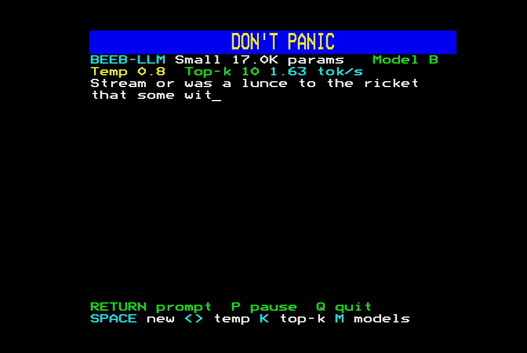
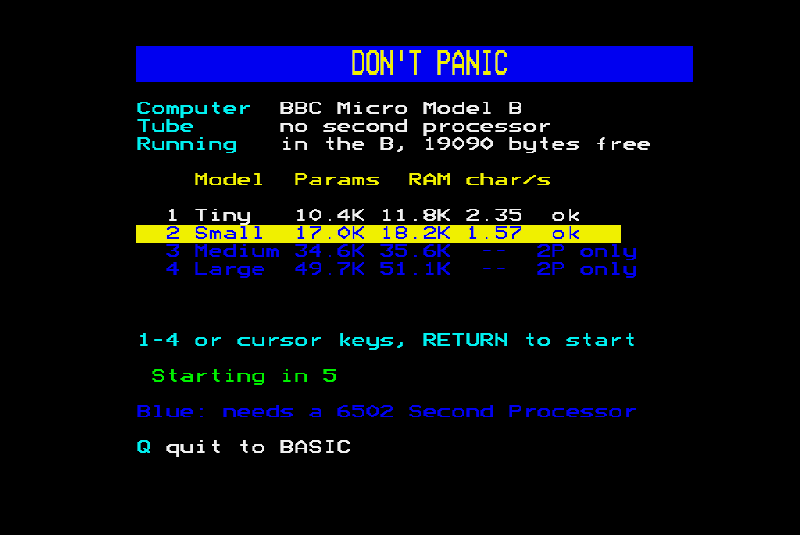
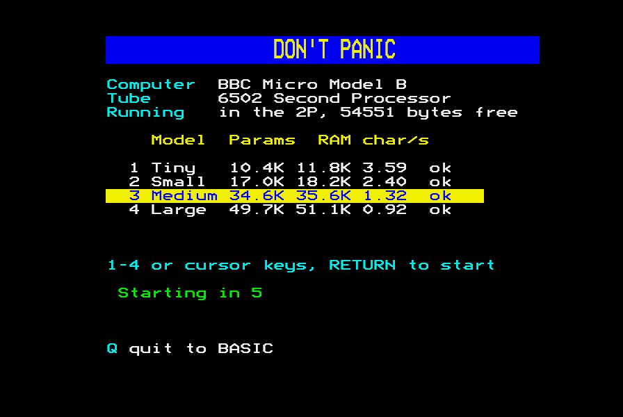
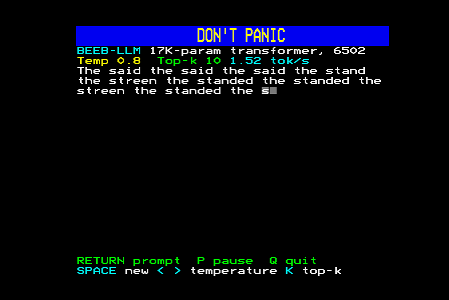

# BEEB-LLM

**A transformer language model running natively on a 1981 BBC Micro Model B**
(6502 at 2 MHz, 32K RAM, OS 1.20), in MODE 7, typing out new text a character
at a time. It's pure integer 6502 machine code. It runs on a plain Model B, and
if it finds a **6502 Second Processor** it runs there instead, with room for
models three times the size.

**Play it in your browser:** https://bobstrogg.github.io/beeb-llm/ (jsbeeb, Model B)
or https://bobstrogg.github.io/beeb-llm/?machine=2p (Model B + 6502 Second Processor)



It's a real (very small) GPT-style network: token embedding, two transformer
blocks with multi-query self-attention and a ReLU MLP, RMSNorm, and an output
layer over a 47-character alphabet. It was trained on a PC, quantised to 8-bit
integers, and is run by a 5.4 KB inference engine on the Beeb. The 6502's
output matches a Python reference model **bit for bit**: every logit and every
sampled character.

This build is trained on a public-domain stand-in, Jerome K. Jerome's *Three
Men in a Boat* and *Three Men on the Bummel*. The pipeline is set up so you
can drop in your own copy of *The Hitchhiker's Guide to the Galaxy* and
retrain with one command ([below](#train-it-on-your-own-book)).

## Four models, one disc

The disc holds four models trained the same way on the same text. At boot
BEEB-LLM checks for a second processor (OSBYTE &EA) and which machine it is on
(OSBYTE 0), shows a menu of the models with their size, speed on this machine
and whether they fit, and after five seconds starts the default:
the biggest model that fits **and** manages at least one character a second.
That's **Small** on a Model B and **Medium** on a second processor.
Pick another with 1–4 or the cursor keys and RETURN; **M** brings the menu
back at any time.

| Model | Params | Shape | RAM | Bits/char | Chars/s Model B | Chars/s 2P | Sample (seed 1234, temp 0.8, top-k 10, prompt "the ") |
|---|---|---|---|---|---|---|---|
| **Tiny** | 10,447 | 2 × d24, MLP 48 | 11.8 KB | 2.33 | 2.35 | 3.59 | the sleep about of a speare fied to stortaine thame." / "i shall old and my were finish mind… |
| **Small** | 16,975 | 2 × d32, MLP 64 | 18.2 KB | 2.22 | 1.57 | 2.40 | the times a she watch his being to mysely take affuling if you dear, whichings. the seemed of… |
| **Medium** | 34,639 | 2 × d48, MLP 96 | 35.6 KB | 2.05 | doesn't fit | 1.32 | the top of children and the tail because, and a looked tasten, they boat. she metholing to… |
| **Large** | 49,679 | 3 × d48, MLP 96 | 51.1 KB | 2.00 | doesn't fit | 0.92 | the toiment shutted off it the sobatheth, to stains to say, in the ocertain, and still me as… |

Bits per character are for the integer model on held-out text (lower is
better). Speeds were measured in jsbeeb over 6 × 200 characters with
`test/verify.mjs`; the Second Processor is a 3 MHz 65C02, about 1.53× faster.
Medium and Large need the second processor's memory (and wider rows than the
Model B's zero-page accumulators allow), so the Model B menu shows them in blue.




How the sizes were chosen: a sweep of 10 shapes (6,000 + 1,000 QAT steps each)
for the best bits per character per 6502 cycle. Two layers of width 24 beat one
layer of 32 and two of 16 for Tiny; for Medium, d48 × 2 layers (2.160 bpc, 1.33
chars/s on the 2P) beat d40 × 3 (2.153, 1.23) and d32 × 4 (2.159, 1.30) on
speed for the same quality; for Large, d48 × 3 (2.079) beat d56 × 2 (2.114).
The chosen four were then trained for 14,000 + 3,000 steps.

## What it writes

These are real outputs from the stand-in Small model (identical on the Beeb and in
`tools/intref.py`). The Beeb adds the capital letters as it types:

> **The meaning of life**. He rawing it out they had been spood him, while mething the black all set which an into sung to only with the river, I sin to get toms, and I addle...

> Since is a sort of the were of the same of the bank of the third, which a past the possibly of the tree that we had not me window it want and too state the could Harris and I have towed himself... *(temperature 0.6, top-k 5)*

> **George said** he handers in this see a should be a said: "I said the rail to be and I was they said: "What was to take that it. I don't you are of them...

> **Montmorency** him a band, that moment you are in its water to dress of a storice in long to get be for the laughed I did not hear whom a lease...

With 17,000 parameters it learns spelling, common words, punctuation, dialogue
layout and the cast (George, Harris, Montmorency, the river, the boat), but not
meaning. That's about what to expect from a model 10,000 times smaller than the
smallest "chat" models. Greedy decoding (top-k 1) falls into loops such as "the
same the same...", so the default is temperature 0.8 with top-k 10.

## Controls

| Key | |
|---|---|
| SPACE | new sample (random seed from the VIA timers) |
| RETURN | type a prompt on the bottom line, then RETURN (ESCAPE cancels). The prompt is fed through the model first, so you watch it "read" it |
| `<` `>` (or `,` `.`) | temperature 0.3, 0.5, 0.6, 0.7, **0.8**, 0.9, 1.0, 1.1, 1.2, 1.5 |
| K | top-k: off, 1 (greedy), 3, 5, **10**, 20 |
| P | pause / resume |
| M | back to the model menu |
| Q or ESCAPE | quit to BASIC (`*RUN LLM`, or `*RUN LLMP` on a second processor, starts it again) |

The status line shows temperature, top-k and the measured speed in tokens per
second (one token = one character). The web page also has on-screen buttons
and a prompt box for phones.



## Model (Small)

| | |
|---|---|
| Architecture | decoder-only transformer, pre-norm, 2 layers |
| Width | d = 32, 4 query heads of 8, **multi-query attention** (one shared key/value head) |
| MLP | 32 → 64 → 32, ReLU |
| Position | no position embedding: a **learned relative bias per head and distance**, so the KV cache is a ring buffer and generation runs forever over a sliding 32-character window |
| Norm | gainless RMSNorm (gains fold into the next matrix) |
| Vocabulary | 47 symbols: newline, space, a–z, `.,'"-;:!?`, 0–9 |
| Parameters | **16,975** (16,320 weights, 399 biases, 256 relative-position biases) |
| Storage | 17,630 bytes: int8 weights, int16 biases, plus the norm and exp tables |
| Quality | about 2.2–2.3 bits per character on held-out text (float 2.25, QAT 2.29, integer model 2.22 on its own sample of windows) |
| Speed | **1.57 characters/s** on a Model B (about 1.27 million 6502 cycles per character, measured in jsbeeb), 2.40 on a 6502 Second Processor |

Memory map, Model B (PAGE = &1900; program `LLM`):

| Address | Contents |
|---|---|
| &0000–&007F | zero page: 64 16-bit accumulators (BASIC is restarted on exit) |
| &0900–&0CFF | quarter-square table f(n) = ⌊n²/4⌋, n = −256…255, built at start-up |
| &1900–&2E14 | code, screen text, tables (5.4 KB) |
| &2E15–&316D | activations and buffers |
| &316E–&7BFF | 19,090 bytes for a model and its KV cache (or the menu overlay) |
| &7C00–&7FFF | MODE 7 screen |

On a 6502 Second Processor (program `LLMP`) the code starts at &0800, the
multiply table goes in BASIC's old workspace at &0400, the accumulators move
to a page-aligned buffer (128 rows) and 54,551 bytes from &22E9 to &F7FF are
free for the model. Its screen output goes across the Tube through OSWRCH,
the same as the Model B build.

### Model files and the menu

`tools/export_beeb.py` writes each model as a relocatable file (`M0`–`M3`): a
20-byte header (d, layers, MLP width, context, vocabulary, norm and output
shifts, offsets) and a 30-byte entry per layer with the offsets of its
matrices and its shifts. The engine loads the file at the end of its own
data, adds the load address to every offset and gives each layer a slice of
KV cache after the model, so one engine runs every shape (head size is fixed
at 8; d, layers, MLP width and context come from the header). The boot menu
(`MENU` / `MENUP`) is an overlay loaded into the same space. `!BOOT` is one
line of BASIC that asks OSBYTE &EA whether there is a Tube and runs `LLMP` or
`LLM`.

### Size / quality trade-off (the first, Small-sized sweep)

All runs used the same corpus and 8,000 float steps plus 2,000 QAT steps.
Bits per character on held-out text:

| Config | Params | Float | QAT int8 |
|---|---|---|---|
| d32, 2 layers, context 64 | 17.2K | 2.273 | 2.291 |
| **d32, 2 layers, context 32** (shipped, then trained longer) | 17.0K | 2.281 | 2.286 |
| d48, 1 layer, context 64 | 20.1K | 2.359 | 2.374 |
| d24, 3 layers, context 64 | 17.1K | 2.255 | 2.285 |

Doubling the context to 64 barely helps a character model this small, but it
costs 1 KB of KV cache and about 20% of the speed, so the Beeb uses 32. Depth
beats width: one wide layer is clearly worse. Three narrow layers are
marginally better, but head size 6 doesn't suit the 6502 code.

## How it works on a 6502

* **Multiply.** a·w = f(a+w) − f(w−a) with f(n) = ⌊n²/4⌋ (the floors cancel
  because a+w and w−a have the same parity). Matrices are stored column by
  column with each weight biased by +128, so a weight is directly the `Y`
  index. For each input activation `a`, four zero-page pointers are set once
  (`&0900+(a+128)`, `&0900+(128−a)` and the same into the high-byte table).
  The inner loop is then: `LDY w,X`, then four `(ptr),Y` loads for the 16-bit
  product, then add it into a 16-bit accumulator. That's about 60 cycles per
  multiply-accumulate, and columns whose input is zero (common after the ReLU)
  are skipped.
* **Everything is a power of two.** Each weight matrix has one scale 2^−k and
  each activation is int8 at a fixed 2^−k scale. Requantising is just an
  arithmetic shift with saturation, with the rounding constant folded into the
  bias. The weight precision of each matrix is capped during training, so its
  16-bit accumulators cannot overflow on real text (the reference counts this:
  zero overflows).
* **RMSNorm.** Pre-shift the 16-bit residual so its largest element is 64–127,
  sum the squares (24-bit) from the same table (x² = f(2x)), normalise that to
  an 8-bit mantissa m and an exponent e, and multiply every element by a
  `1/sqrt(m)` table entry, then shift by e.
* **Softmax.** Scores are in 1/8-nat units. `e = EXP[max − s]` comes from a
  64-entry table, 127·exp(−i/8). Attention sums e·v in 24 bits and divides by
  Σe with an 8-step restoring division.
* **Sampling.** Logits × (16/temperature) >> 4, then the exp table, an
  optional top-k pass, and a pick from Σe using a xorshift16 generator
  (rejection sampling, no bias).
* **Bit-exact.** [`tools/intref.py`](tools/intref.py) is the specification. It
  does exactly the same integer operations in Python, and
  [`test/verify.mjs`](test/verify.mjs) runs the real disc in headless jsbeeb
  with fixed seeds, temperatures, top-k values and a prompt, then compares
  every sampled character (and, with `HOOK=1`, the 47 logits behind each one).

Where the time goes (Small, profiled in jsbeeb): 69% multiply-accumulate inner
loop, 6% shifts, 5% OS (interrupts and screen output), 5% attention
bookkeeping, 3.5% division, 3% norms, the rest sampling and display.

## Train it on your own book

You need Python 3 with PyTorch (the CPU build is fine) and numpy, plus BeebAsm
on your PATH.

```sh
cp ~/books/hitchhikers.txt corpus/hhgttg.txt     # your own copy, plain text
./retrain.sh                                     # all four sizes, ~30 minutes on an 8-core CPU
```

`retrain.sh` uses `corpus/hhgttg.txt` when it exists, otherwise it downloads
the stand-in. It normalises the text to the 47-symbol alphabet
([`tools/prepare_corpus.py`](tools/prepare_corpus.py)), trains in float and
then with quantisation-aware training that simulates the Beeb's integer maths
([`tools/train.py`](tools/train.py), [`tools/model.py`](tools/model.py)),
checks the integer model, exports the Beeb layout
([`tools/export_beeb.py`](tools/export_beeb.py)), assembles the disc and builds
the MMFS image. Any plain-text file works: `./retrain.sh path/to/book.txt`.
`QUICK=1 ./retrain.sh` does a short run to test the pipeline, and
`SIZES="tiny small" ./retrain.sh` retrains only some sizes. The four sizes
train side by side and all go on the one disc.

**Copyright:** neither corpora nor weights trained on them are committed. Only
the public-domain stand-in models (`models/standin-*.npz`) are in the repository
and on the web page. A model trained on your own book is written to `build/`
only (`build/beeb-llm.ssd`, `build/BEEB-LLM.MMB.zip`) for your own machines.

To rebuild the shipped disc from the committed weights without training:
`./build_disc.sh`.

## Running it on a real BBC Micro

* **Floppy / Gotek / any DFS:** write [`discs/beeb-llm.ssd`](discs/beeb-llm.ssd)
  and press SHIFT+BREAK.
* **MMFS / Turbo MMC (MicroSD):** [`discs/BEEB-LLM.MMB.zip`](discs/BEEB-LLM.MMB.zip)
  holds a complete `BEEB.MMB` (rename `BEEB-LLM.MMB` to `BEEB.MMB`) with
  BEEB-LLM in slot 0. To add it to your existing card instead, put the `.ssd`
  into a free slot with MMB_Utils, e.g.
  `perl vendor/MMB_Utils/dput_ssd.pl -f BEEB.MMB 4 discs/beeb-llm.ssd`, then
  on the Beeb `*DIN 4` and SHIFT+BREAK (or `*RUN LLM`).

It needs a Model B with DFS or MMFS (PAGE = &1900); a 6502 Second Processor
is used if present. On the Model B it uses the RS423/cassette buffers,
soft-key buffer and user-character area (&0900–&0CFF) for its multiply table,
so soft keys are cleared on exit. Sideways RAM and Master shadow RAM are
detected by neither build: the Model B build keeps the 17K model as its
biggest, and a second processor is the way to run the larger ones.

## Building and testing

```sh
git clone --recursive https://github.com/BobStrogg/beeb-llm
(cd vendor/jsbeeb && npm install)        # the headless emulator and Playwright
./build_disc.sh                          # needs beebasm, perl (MMB_Utils), python3 + numpy
test/run-all.sh                          # bit-exact check, boot/quit checks, browser check
node test/browser.mjs https://bobstrogg.github.io/beeb-llm/   # the live site
```

* `test/verify.mjs [N]`: headless jsbeeb on a Model B and on a Model B +
  6502 Second Processor, every model that fits, six fixed cases each (various
  seeds, temperatures 0.5–1.2, top-k off/1/5/10/20 and a typed prompt);
  compares N tokens with the Python reference and measures characters per
  second (`HOOK=1` compares the logits too).
* `test/boot.mjs`: on both machines, SHIFT+BREAK to the menu and the auto-picked
  default, M back to the menu, Q, ESCAPE and Q-in-the-menu back to a working
  BASIC, `*RUN LLM`/`*LLM` (`LLMP` on the second processor). Screenshots in
  `screenshots/`.
* `test/browser.mjs`: the web page in headless Chrome for both machines,
  including the prompt box and buttons.
* `test/profile.mjs`: cycle profile by routine.

BeebAsm was built from `vendor/beebasm-src`. The web page uses a prebuilt
jsbeeb in `web/jsbeeb` and is deployed by `.github/workflows/pages.yml`.

## Possible next steps

* Streaming weights from disc or sideways RAM for still bigger models.
* 4-bit weights with per-column multiple tables: roughly twice the parameters
  in the same memory, at a similar speed.

## Licence

Our code is MIT ([LICENSE](LICENSE)). jsbeeb (`vendor/jsbeeb`, and the
prebuilt copy in `web/jsbeeb`) is GPL-3.0, BeebAsm is GPL-3.0 and MMB_Utils
has its own licence; they are included as submodules. The stand-in corpus is
public domain (Project Gutenberg); it is downloaded, not redistributed.
